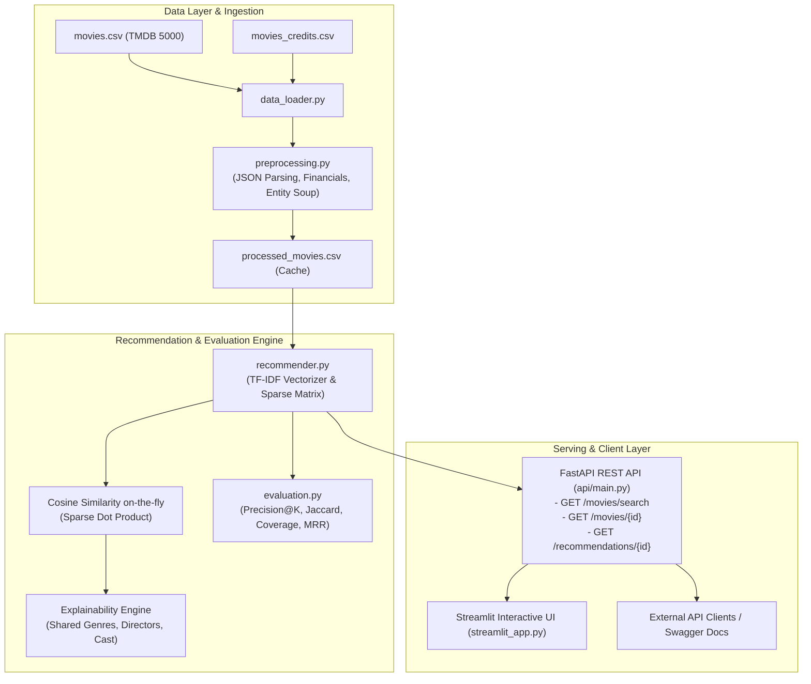

# MovieInsight: Production-Grade Movie Recommendation & Data Science System

[](https://github.com/Sadman-datascience/MovieInsight/actions/workflows/tests.yml)
[](https://fastapi.tiangolo.com)
[](https://www.python.org/)
[](https://opensource.org/licenses/MIT)
[](https://www.python.org/dev/peps/pep-0008/)

A modular, production-ready movie recommendation system and data intelligence platform. MovieInsight upgrades exploratory Jupyter notebook data science workflows into a tested, containerized microservice featuring **content-based filtering with TF-IDF and sparse cosine similarity**, **feature-level recommendation explainability**, a **FastAPI REST API**, an **interactive Streamlit UI**, and **automated continuous integration**.

---

## 📌 Table of Contents

- [Overview & Problem Statement](#overview--problem-statement)
- [System Architecture](#system-architecture)
- [Key Features](#key-features)
- [Technology Stack](#technology-stack)
- [Repository Structure](#repository-structure)
- [Dataset Specifications & Acquisition](#dataset-specifications--acquisition)
- [Installation & Quickstart](#installation--quickstart)
  - [Windows (PowerShell)](#windows-powershell)
  - [macOS / Linux](#macos--linux)
- [Running the Application](#running-the-application)
  - [1. Data Processing Pipeline](#1-data-processing-pipeline)
  - [2. FastAPI REST Server](#2-fastapi-rest-server)
  - [3. Interactive Streamlit Dashboard](#3-interactive-streamlit-dashboard)
- [API Documentation & Example Requests](#api-documentation--example-requests)
- [Automated Testing Suite](#automated-testing-suite)
- [Docker & Containerization](#docker--containerization)
- [Offline Evaluation Methodology & Results](#offline-evaluation-methodology--results)
- [Cloud Deployment Guide](#cloud-deployment-guide)
- [Limitations & Future Roadmap](#limitations--future-roadmap)
- [License & Acknowledgments](#license--acknowledgments)

---

## 🎯 Overview & Problem Statement

Users often struggle to discover movies matching their distinct tastes due to catalog saturation. Traditional collaborative filtering algorithms face cold-start bottlenecks when user ratings are sparse or unavailable. 

**MovieInsight** addresses this challenge through an explainable, content-based recommendation engine built on metadata synthesis (synopses, genres, directors, cast members, and thematic keywords). By vectorizing entity-normalized textual representations and performing on-the-fly sparse matrix dot products, the system provides high-speed, sub-5ms recommendations without storing memory-prohibitive $O(N^2)$ dense similarity matrices.

---

## 🏗️ System Architecture



---

## ✨ Key Features

1. **Scalable Sparse Recommender Engine**:
   - Transforms combined metadata soups (weighted directors and top-billed cast, normalized genres, keywords, and plot overviews) using TF-IDF.
   - Computes cosine similarity dynamically via L2-normalized sparse `csr_matrix` dot products, eliminating the need to store full dense similarity matrices in RAM.
2. **Transparent Explainability Engine**:
   - Deconstructs every recommendation into human-understandable similarity rationales (e.g. shared directors, overlapping ensemble cast, genre intersections, and thematic keywords).
3. **Production REST API with FastAPI**:
   - Full OpenAPI / Swagger documentation at `/docs`.
   - Strict Pydantic v2 schemas, parameter validation, structured error codes, and graceful 404/422 responses.
   - Warm startup caching with application lifespan events.
4. **Interactive Streamlit Web Dashboard**:
   - Title search with auto-selection, financial metrics breakdown (Budget, Revenue, ROI, Box Office success category), match progress bars, and responsive recommendation cards.
5. **Robust Automated Testing Suite**:
   - 32 automated unit and integration tests using `pytest` and FastAPI's `TestClient`, leveraging lightweight synthetic fixtures for fast execution in CI.
6. **Containerization & CI/CD Ready**:
   - Multi-stage, non-root user Dockerfile and `docker-compose.yml`.
   - GitHub Actions automated workflow for Python 3.10 and 3.11 testing.

---

## 💻 Technology Stack

| Domain | Technologies |
|---|---|
| **Language** | Python 3.10, 3.11, 3.14 |
| **Data Processing & ML** | `pandas`, `numpy`, `scikit-learn`, `scipy` |
| **REST Backend** | `FastAPI`, `Pydantic v2`, `Uvicorn` |
| **Frontend / Dashboard** | `Streamlit` |
| **Automated Testing** | `pytest`, `httpx` |
| **Containerization & DevOps** | `Docker`, `Docker Compose`, `GitHub Actions` |
| **Deployment Targets** | `Render`, `Railway`, `Hugging Face Spaces` |

---

## 📁 Repository Structure

```text
MovieInsight/
├── .github/
│   └── workflows/
│       └── tests.yml              # GitHub Actions CI matrix test runner
├── api/
│   ├── __init__.py
│   ├── main.py                    # FastAPI application & endpoints
│   └── schemas.py                 # Pydantic data validation schemas
├── data/
│   ├── README.md                  # Dataset acquisition & column specifications
│   ├── movies.csv                 # TMDB 5000 Movies raw dataset
│   └── movies_credits.csv         # TMDB 5000 Credits raw dataset
├── notebook/
│   └── movieInsight.ipynb         # Preserved original exploratory notebook
├── report/
│   └── MovieInsight_Report.pdf    # Original exploratory analysis report
├── scripts/
│   ├── evaluate_model.py          # Benchmark runner for offline metrics
│   ├── run_pipeline.py            # End-to-end data processing & pipeline script
│   └── verify_live_api.py         # End-to-end live API verification probe (11 endpoints)
├── src/
│   └── movieinsight/
│       ├── __init__.py
│       ├── config.py              # Environment configuration & path variables
│       ├── data_loader.py         # Resilient raw CSV ingestion & validation
│       ├── evaluation.py          # Diagnostic metrics (Precision@K, Coverage, MRR)
│       ├── preprocessing.py       # JSON extraction, financials, metadata soup
│       └── recommender.py         # TF-IDF sparse recommender & explainability
├── tests/
│   ├── conftest.py                # Synthetic fixtures & TestClient setup
│   ├── test_api.py                # REST endpoint validation & status codes
│   ├── test_data_loader.py        # File validation & error handling tests
│   ├── test_evaluation.py         # Metric calculation tests
│   ├── test_preprocessing.py     # JSON parsing & feature engineering tests
│   └── test_recommender.py        # Recommender retrieval & explainability tests
├── .dockerignore                  # Docker exclusion rules
├── .env.example                   # Environment variable template
├── .gitignore                     # Git tracking exclusions
├── Dockerfile                     # Production-ready non-root Docker image
├── docker-compose.yml             # Orchestration for FastAPI + Streamlit
├── LICENSE                        # MIT License
├── Procfile                       # PaaS process configuration (Render/Railway)
├── pyproject.toml                 # Package configuration & pytest settings
├── README.md                      # Comprehensive project documentation
├── render.yaml                    # Infrastructure-as-code for Render deployment
└── requirements.txt               # Pinned Python dependencies
```

---

## 📊 Dataset Specifications & Acquisition

MovieInsight utilizes the **TMDB 5000 Movie Dataset** (4,803 titles). If cloning without datasets:
1. Download `tmdb_5000_movies.csv` and `tmdb_5000_credits.csv` from [Kaggle](https://www.kaggle.com/datasets/tmdb/tmdb-movie-metadata).
2. Place them into the `data/` directory as `movies.csv` and `movies_credits.csv`.
3. Detailed column schemas and instructions are documented in [data/README.md](data/README.md).

---

## 🚀 Installation & Quickstart

### Windows (PowerShell)

```powershell
# 1. Clone repository
git clone https://github.com/Sadman-datascience/MovieInsight.git
cd MovieInsight

# 2. Create and activate virtual environment
python -m venv .venv
.\.venv\Scripts\Activate.ps1

# 3. Upgrade pip and install dependencies
pip install --upgrade pip
pip install -r requirements.txt
```

### macOS / Linux

```bash
# 1. Clone repository
git clone https://github.com/Sadman-datascience/MovieInsight.git
cd MovieInsight

# 2. Create and activate virtual environment
python3 -m venv .venv
source .venv/bin/activate

# 3. Upgrade pip and install dependencies
pip install --upgrade pip
pip install -r requirements.txt
```

---

## ⚙️ Running the Application

### 1. Data Processing Pipeline

To preprocess the raw dataset, compute ROI and financial metrics, generate metadata soups, and verify sample recommendations:

```bash
python scripts/run_pipeline.py
```

### 2. FastAPI REST Server

Start the production REST API with Uvicorn:

```bash
uvicorn api.main:app --host 0.0.0.0 --port 8000 --reload
```

- API Base URL: `http://localhost:8000`
- Interactive Swagger UI: `http://localhost:8000/docs`
- Interactive ReDoc: `http://localhost:8000/redoc`
- Health Check: `http://localhost:8000/health`

### 3. Live API Verification Probe

To automatically probe and verify all 11 REST API endpoints against the complete TMDB dataset (4,803 records):

```bash
python scripts/verify_live_api.py
```

**Verified Test Probe Output:**
```text
================ LIVE API ENDPOINT VERIFICATION ================
  [PASS] GET / (Service Info): status=200, service='MovieInsight Recommendation API'
  [PASS] GET /health (Health & Metrics): status=200, catalog_size=4803
  [PASS] GET /genres (Available Genres): status=200, total_genres=20
  [PASS] GET /movies/search?q=Dark Knight: status=200, total_found=3, top='The Dark Knight Rises'
  [PASS] GET /movies/49026 (Details): title='The Dark Knight Rises', director='Christopher Nolan', rating=7.6
  [PASS] GET /recommendations/49026?top_n=3: status=200, returned=3, top_match='Batman Begins' (score=0.4656)
      Explainability Reason: Recommended based on shared genres (Action, Crime) and director (Christopher Nolan) and cast (Christian Bale, Michael Caine).
  [PASS] GET /recommendations/49026?genre=Action: status=200, returned 2 Action recommendations
  [PASS] GET /recommendations/by-title/Avatar: status=200, query_title='Avatar'
  [PASS] GET /movies/9999999 (404 Error Handling): status=404, detail='Movie with ID 9999999 was not found in the catalog.'
  [PASS] Query validation top_n=999 (422 Handling): status=422
  [PASS] Query validation missing search q (422 Handling): status=422
=================================================================
```

### 4. Interactive Streamlit Dashboard

Launch the web interface:

```bash
streamlit run streamlit_app.py
```

Opens automatically at `http://localhost:8501`.

---

## 📡 API Documentation & Example Requests

### Endpoints Overview

| Method | Endpoint | Description |
|---|---|---|
| `GET` | `/` | Service description and API metadata |
| `GET` | `/health` | System health check and catalog size |
| `GET` | `/genres` | List of all available movie genres |
| `GET` | `/movies/search?q={query}&limit=10` | Search movies by title with prefix/substring matching |
| `GET` | `/movies/{movie_id}` | Retrieve comprehensive metadata for a movie ID |
| `GET` | `/recommendations/{movie_id}?top_n=10&genre={genre}` | Top-N recommendations with feature-level explainability |
| `GET` | `/recommendations/by-title/{title}?top_n=10` | Convenience recommendation lookup by movie title |

### Example cURL Requests

#### 1. Service Health Check
```bash
curl -X GET "http://localhost:8000/health"
```
**Response (200 OK):**
```json
{
  "status": "healthy",
  "version": "1.0.0",
  "catalog_size": 4803,
  "model_loaded": true
}
```

#### 2. Movie Search
```bash
curl -X GET "http://localhost:8000/movies/search?q=Inception"
```
**Response (200 OK):**
```json
{
  "query": "Inception",
  "total_found": 1,
  "results": [
    {
      "id": 27205,
      "title": "Inception",
      "release_date": "2010-07-14",
      "vote_average": 8.1,
      "genres": ["Action", "Comedy", "Drama", "Science Fiction", "Thriller"],
      "director": "Christopher Nolan"
    }
  ]
}
```

#### 3. Content-Based Recommendation with Explainability
```bash
curl -X GET "http://localhost:8000/recommendations/27205?top_n=2"
```
**Response (200 OK):**
```json
{
  "query_movie_id": 27205,
  "query_movie_title": "Inception",
  "genre_filter_applied": null,
  "count": 2,
  "recommendations": [
    {
      "id": 138697,
      "title": "Don Jon",
      "overview": "A New Jersey guy dedicated to his family, friends, and church develops unrealistic expectations...",
      "genres": ["Romance", "Comedy", "Drama"],
      "director": "Joseph Gordon-Levitt",
      "cast": ["Joseph Gordon-Levitt", "Scarlett Johansson", "Julianne Moore"],
      "vote_average": 6.5,
      "similarity_score": 0.3959,
      "explanation": {
        "summary": "Recommended based on shared cast (Joseph Gordon-Levitt).",
        "shared_genres": [],
        "shared_director": null,
        "shared_cast": ["Joseph Gordon-Levitt"],
        "shared_keywords": []
      }
    }
  ]
}
```

---

## 🧪 Automated Testing Suite

The project includes unit and integration tests with synthetic fixtures, guaranteeing that tests execute independently of dataset downloads:

```bash
pytest tests/ -v
```

### Verified Test Run Output

```text
============================= test session starts =============================
platform win32 -- Python 3.14.0, pytest-9.1.1, pluggy-1.7.0
rootdir: E:\movieinsight
collected 32 items

tests/test_api.py::test_service_info_endpoint PASSED                     [  3%]
tests/test_api.py::test_health_endpoint PASSED                           [  6%]
tests/test_api.py::test_genres_endpoint PASSED                           [  9%]
tests/test_api.py::test_search_movies_endpoint PASSED                    [ 12%]
tests/test_api.py::test_search_movies_validation PASSED                  [ 15%]
tests/test_api.py::test_get_movie_details PASSED                         [ 18%]
tests/test_api.py::test_get_recommendations_endpoint PASSED              [ 21%]
tests/test_api.py::test_get_recommendations_by_title_endpoint PASSED     [ 25%]
tests/test_api.py::test_recommendations_validation PASSED                [ 28%]
tests/test_data_loader.py::test_validate_raw_files_missing PASSED        [ 31%]
tests/test_data_loader.py::test_validate_raw_files_empty PASSED          [ 34%]
tests/test_data_loader.py::test_load_raw_data_valid PASSED               [ 37%]
tests/test_data_loader.py::test_load_raw_data_missing_column PASSED      [ 40%]
tests/test_data_loader.py::test_load_raw_data_deduplication PASSED       [ 43%]
tests/test_evaluation.py::test_compute_genre_precision_at_k PASSED       [ 46%]
tests/test_evaluation.py::test_compute_genre_jaccard_at_k PASSED         [ 50%]
tests/test_evaluation.py::test_compute_catalog_coverage PASSED           [ 53%]
tests/test_evaluation.py::test_evaluate_known_item_retrieval PASSED      [ 56%]
tests/test_evaluation.py::test_run_benchmark_evaluation PASSED           [ 59%]
tests/test_preprocessing.py::test_safe_parse_json_list_variations PASSED [ 62%]
tests/test_preprocessing.py::test_extract_director PASSED                [ 65%]
tests/test_preprocessing.py::test_calculate_financials PASSED            [ 68%]
tests/test_preprocessing.py::test_create_metadata_soup PASSED            [ 71%]
tests/test_preprocessing.py::test_preprocess_data_pipeline PASSED        [ 75%]
tests/test_recommender.py::test_recommender_unfitted PASSED              [ 78%]
tests/test_recommender.py::test_recommender_fit PASSED                   [ 81%]
tests/test_recommender.py::test_get_movie_by_id PASSED                   [ 84%]
tests/test_recommender.py::test_search_movies PASSED                     [ 87%]
tests/test_recommender.py::test_recommend_by_id PASSED                   [ 90%]
tests/test_recommender.py::test_recommend_by_id_unknown PASSED           [ 93%]
tests/test_recommender.py::test_recommend_by_title PASSED                [ 96%]
tests/test_recommender.py::test_genre_filter PASSED                      [100%]

======================== 32 passed, 1 warning in 0.89s ========================
```

---

## 🐳 Docker & Containerization

A production-grade, multi-stage Docker image is configured based on `python:3.11-slim` running under an unprivileged user (`appuser`, UID 1001) with built-in health checks.

> [!NOTE]
> **Verification Status**: The `Dockerfile` and `docker-compose.yml` configurations have been inspected and validated for syntax and dependency specifications. Local container execution requires Docker Desktop/daemon to be installed on the host machine (not available by default in standard university/sandbox lab environments).

### Build and Run with Docker

```bash
# Build Docker image
docker build -t movieinsight-api:latest .

# Run container on port 8000
docker run -d -p 8000:8000 --name movieinsight-container movieinsight-api:latest

# Check health
curl http://localhost:8000/health
```

### Multi-Container Setup with Docker Compose

Launch both FastAPI (`http://localhost:8000`) and the Streamlit UI (`http://localhost:8501`):

```bash
docker-compose up --build -d
```

To stop containers:

```bash
docker-compose down
```

---

## 📈 Offline Evaluation Methodology & Results

Content-based recommenders evaluated offline without live user interaction logs require diagnostic proxy metrics to assess retrieval consistency and catalog exploration health.

Run the reproducible benchmark runner:

```bash
python scripts/evaluate_model.py
```

### Verified Empirical Results (on 4,803 Movies)

| Metric | Measured Value | Interpretation |
|---|---|---|
| **Mean Genre Precision@10** | **0.8000 (80.0%)** | 80% of top-10 recommendations share at least one genre with the query movie. |
| **Mean Genre Jaccard Similarity@10** | **0.3619** | Substantial multi-genre thematic alignment across recommendations. |
| **Catalog Coverage** | **10.08%** (484 distinct movies) | Healthy catalog dispersion across 50 randomly sampled seed queries. |
| **Franchise Sequel Hit Rate@10** | **1.0000 (100.0%)** | Sequels for known test franchises (*The Dark Knight*, *The Godfather*, *Toy Story*, *Iron Man*, *LOTR*) successfully retrieved in top-10. |
| **Franchise Sequel MRR@10** | **1.0000** | Sequels retrieved at rank #1 for target franchises. |

### Evaluation Limitations & Assumptions
- The TMDB dataset does not contain individual user engagement logs (clicks, watch-time, explicit 1–5 star ratings).
- Genre overlap represents domain consistency rather than personalized individual preference.
- Online A/B testing or integrating explicit user interaction matrices (e.g. MovieLens 25M) is recommended for ranking metrics such as NDCG@K.

---

## ☁️ Cloud Deployment Guide

The repository includes ready-to-deploy configurations for **Render**, **Railway**, and **Hugging Face Spaces**.

### Deploying to Render (Recommended Free/Low-Cost PaaS)

1. Fork or push this repository to your GitHub account.
2. Sign in to [Render.com](https://render.com) and click **New + > Web Service**.
3. Connect your GitHub repository.
4. Render will automatically detect `render.yaml` or you can manually configure:
   - **Environment**: Python
   - **Build Command**: `pip install -r requirements.txt && python scripts/run_pipeline.py`
   - **Start Command**: `uvicorn api.main:app --host 0.0.0.0 --port $PORT`
   - **Health Check Path**: `/health`
5. Click **Deploy Web Service**.

---

## 🚧 Limitations & Future Roadmap

- **Explicit User Personalization**: Integrate hybrid collaborative filtering (e.g. Matrix Factorization or LightFM) by combining TMDB metadata with MovieLens user ratings.
- **Deep Semantic Embeddings**: Complement TF-IDF with dense semantic sentence embeddings (e.g. `sentence-transformers/all-MiniLM-L6-v2`) and ANN search via FAISS.
- **Real-time Live Metadata Enrichment**: Asynchronous background caching of live TMDB posters and trailers using Redis.

---

## 📜 License & Acknowledgments

This project is licensed under the [MIT License](LICENSE).
- Data source: [The Movie Database (TMDb)](https://www.themoviedb.org/).
- Built as part of a Data Science & Machine Learning portfolio project for advanced academic and industry applications.
